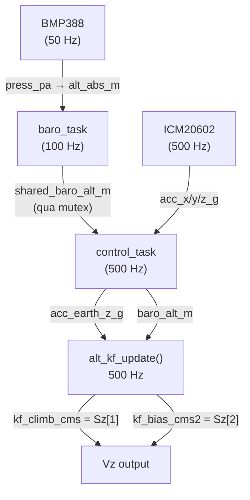
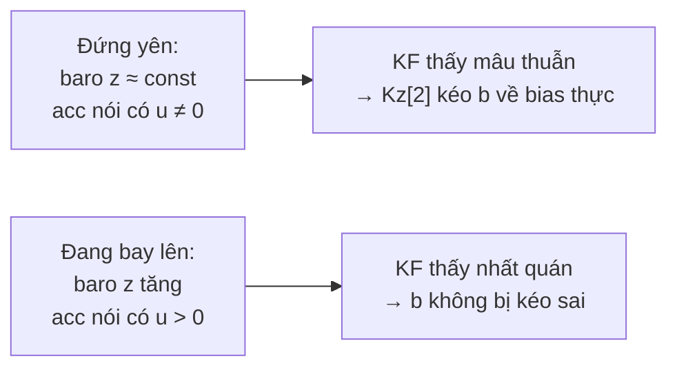

# Phân Tích: Vz Bias Khi Drone Đứng Yên & Giải Pháp KF 3-State

> [!NOTE]
> Ghi nhận từ quá trình debug thực tế trên phần cứng ESP32 + ICM20602 + BMP388.
> Drone đặt đứng yên trên bàn, không arm.

---

## 1. Triệu Chứng Quan Sát

| Điều kiện | `tlm_climb_cms` (Vz) | Ghi chú |
|---|---|---|
| Đứng yên trên bàn | **3–10 cm/s** | Thay đổi theo từng lần khởi động |
| Lý tưởng | ~0 cm/s | Mong muốn |

> [!IMPORTANT]
> Vz **không cố định** ở 1 giá trị — dao động giữa 3–5 hay 7–10 cm/s tùy lần đo.
> Đây là đặc trưng của **DC bias ngẫu nhiên**, phụ thuộc nhiệt độ và góc đặt tại thời điểm đó.

---

## 2. Pipeline KF Độ Cao



---

## 3. Nguyên Nhân Gốc Rễ

### 3.1. DC Bias Trong `acc_earth_z_g`

```c
// control_task.ino
acc_earth_z_g = -sp * acc_x_g + cp * sr * acc_y_g + cp * cr * acc_z_g - 1.0f;
```

Khi đứng yên, lý tưởng `acc_earth_z_g = 0`. Thực tế luôn có **DC bias nhỏ**:

| Nguồn bias | Cơ chế | Ước tính |
|---|---|---|
| Nhiệt độ drift ICM20602 | 0.7 mg/°C | ~3.5 mg (nếu tăng 5°C) |
| Drone không hoàn toàn phẳng | Tilt 0.3° → sin(0.3°)×1g | ~5.2 mg |
| Góc Kalman 1D ước lượng sai | Roll/pitch sai vài phần mười độ | ~1–3 mg |
| **Tổng** | | **~5–15 mg ngẫu nhiên** |

### 3.2. Tại Sao DC Bias → Vz Drift (Không Dao Động Quanh 0)?

```
acc_earth_z_g = [DC bias b] + [noise n(t) zero-mean]
                      ↓                  ↓
           Tích phân 1 chiều     Random walk (dao động)
                      ↓
         Baro correction yếu (Kz[1] rất nhỏ vì σ_baro = 30 cm)
                      ↓
         Cân bằng tại vz ≠ 0 ← đây là Vz ảo quan sát được
```

### 3.3. Tại Sao Kalman Gain Kz[1] Nhỏ?

`σ_baro = 30 cm` được chọn cho điều kiện **bay thực** (propwash làm baro spike 15–30 cm).
→ `Rz = 900 cm²` lớn → Kz nhỏ → baro không đủ kéo vz về 0 chống lại drift IMU.

> [!WARNING]
> Không thể chỉ giảm `σ_baro` để sửa: khi bay, propwash làm baro spike.
> Nếu Kz lớn → vz nhảy loạn → alt hold mất ổn định.

### 3.4. Giải Pháp "Đo Bias 1 Lần Lúc Khởi Động" — Tại Sao Không Đủ

Giải pháp trung gian (đã thử và loại bỏ):
```
Startup (lạnh):   đo bias = 5 mg   → lưu acc_z_earth_bias_g = 5 mg
Bay 2 phút:       motor nóng → chip tăng 10°C → bias thực = 12 mg
                  acc_z_earth_bias_g vẫn = 5 mg (cũ)
                  → residual 7 mg chưa trừ → Vz drift quay lại khi bay
```

---

## 4. Giải Pháp: KF 3-State Tự Ước Lượng Bias

### Model

| | 2-state (cũ) | 3-state (mới) |
|---|---|---|
| Trạng thái | `S = [z, vz]'` | `S = [z, vz, b]'` |
| Ý nghĩa b | — | bias acc_earth_z (cm/s²), KF tự tìm |
| Xử lý bias IMU | ❌ Không | ✅ Tự ước lượng liên tục |
| Chịu nhiệt độ thay đổi | ❌ Không | ✅ Có — b cập nhật liên tục |

### Ma Trận Hệ Thống (DT = 2ms)

```
F = [ 1,  DT,  -0.5·DT² ]     G = [ 0.5·DT² ]     H = [ 1, 0, 0 ]
    [ 0,   1,  -DT      ]         [ DT      ]
    [ 0,   0,   1       ]         [ 0       ]
```

`-b` xuất hiện trong F: mỗi bước Predict **tự động trừ bias ước lượng** ra khỏi `u`.

### Process Noise Q

```
Q = G·G'·σ_acc²  +  diag(0, 0, σ_b²)
```

- `σ_acc = 4 cm/s²` — nhiễu gia tốc (giữ nguyên)
- `σ_b = 0.05 cm/s²` — cho phép b thay đổi chậm (~drift nhiệt độ)

### Cơ Chế Tự Ước Lượng



- **Đứng yên:** baro nói `z` không đổi, acc nói có gia tốc → KF quy cho bias `b`
- **Đang bay:** baro xác nhận có chuyển động → KF không quy cho `b`
- **Sau ~5–10 giây:** `b` hội tụ về bias thực, tiếp tục bám khi nhiệt độ thay đổi

---

## 5. Tham Số Quan Trọng

| Tham số | Giá trị | Ý nghĩa |
|---|---|---|
| `KF_SIGMA_ACC_CMS2` | 4.0 | Độ không chắc chắn của acc (cm/s²) |
| `KF_SIGMA_BARO_CM` | 30.0 | Độ noise baro khi bay (cm) |
| `KF_SIGMA_BIAS_CMS2` | 0.05 | Tốc độ cho phép bias thay đổi (cm/s²/step) |

> [!TIP]
> Nếu bias hội tụ **quá chậm** (vz còn drift lâu khi mới khởi động):
> tăng `KF_SIGMA_BIAS_CMS2` lên 0.1–0.2.
>
> Nếu vz **nhạy quá** (bị kéo bởi nhiễu ngắn hạn):
> giảm `KF_SIGMA_BIAS_CMS2` xuống 0.02.

---

## 6. Các File Thay Đổi

| File | Thay đổi | Trạng thái |
|---|---|---|
| [`altitude_kf.ino`](altitude_kf.ino) | Viết lại KF từ 2-state → 3-state `[z, vz, b]`. Thêm tham số `baro_is_new` — correct chỉ chạy khi baro có mẫu mới (~50 Hz) | ✅ Done |
| [`control_task.ino`](control_task.ino) | Thêm `bool baro_is_new`; `baro_fetch_shared()` đọc và reset `shared_baro_new`; gọi `alt_kf_update(..., baro_is_new)` | ✅ Done |
| [`DroneFC_CRSF_DShot_ManualAcc.ino`](DroneFC_CRSF_DShot_ManualAcc.ino) | `shared_baro_new = true` trong `baro_task` khi có mẫu mới; xóa `acc_z_earth_bias_g` và calibration cũ | ✅ Done |
| [`imu_icm20602.ino`](imu_icm20602.ino) | Hàm `imu_calibrate_acc_earth_z()` vẫn còn nhưng không được gọi | ⚠️ Giữ lại, có thể xóa |

### API Mới Thêm

```cpp
float alt_kf_get_acc_bias_cms2();   // bias đang ước lượng — dùng để debug
```

---

## 7. Kết Quả Kỳ Vọng

| Chỉ số | Trước | Sau (KF 3-state) |
|---|---|---|
| `tlm_climb_cms` khi đứng yên | 3–10 cm/s (ngẫu nhiên) | → 0 trong ~5–10s đầu, giữ ở < 1–2 cm/s |
| Vz khi motor nóng 2 phút | drift quay lại | Tự điều chỉnh theo nhiệt độ |
| Alt hold drift | Trôi không kiểm soát | Ổn định |
| Thời gian khởi động | Không đổi | Không đổi (không còn +1.6s) |

---

## 8. Tóm Tắt

```
Vz ảo 3–10 cm/s = DC bias acc_earth_z (nhiệt độ + góc + drift)
                  tích phân 500 Hz → Kalman gain nhỏ không kéo được về 0

Fix cũ (bỏ):    đo bias 1 lần lúc khởi động → không theo kịp thay đổi khi bay

Fix mới (dùng): KF 3-state [z, vz, b]
                → b tự ước lượng liên tục từ mâu thuẫn giữa acc và baro
                → hoạt động đúng cả khi đứng yên lẫn khi bay
                → tự thích nghi khi nhiệt độ, môi trường thay đổi
```
